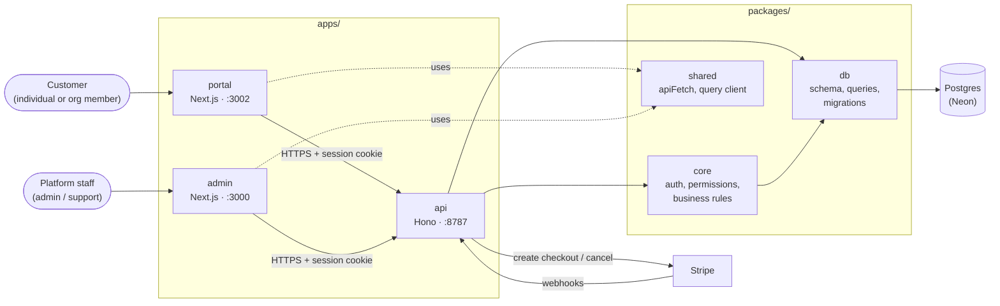
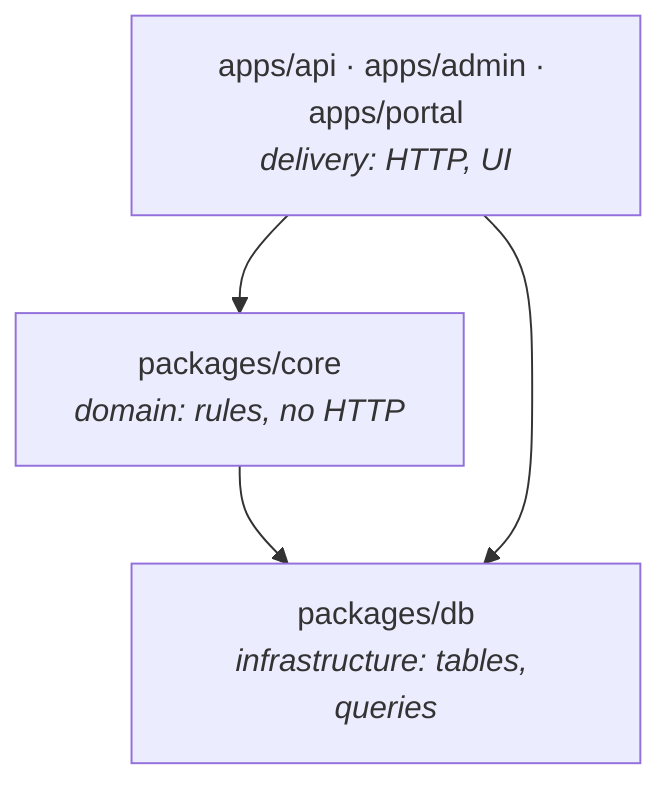
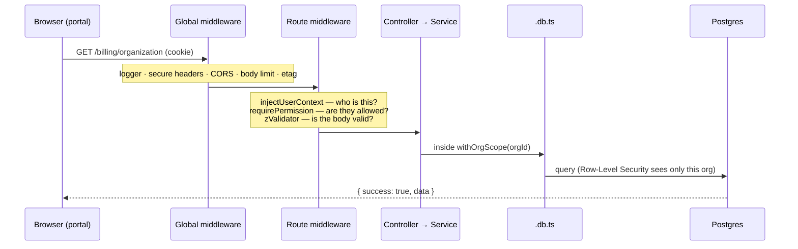
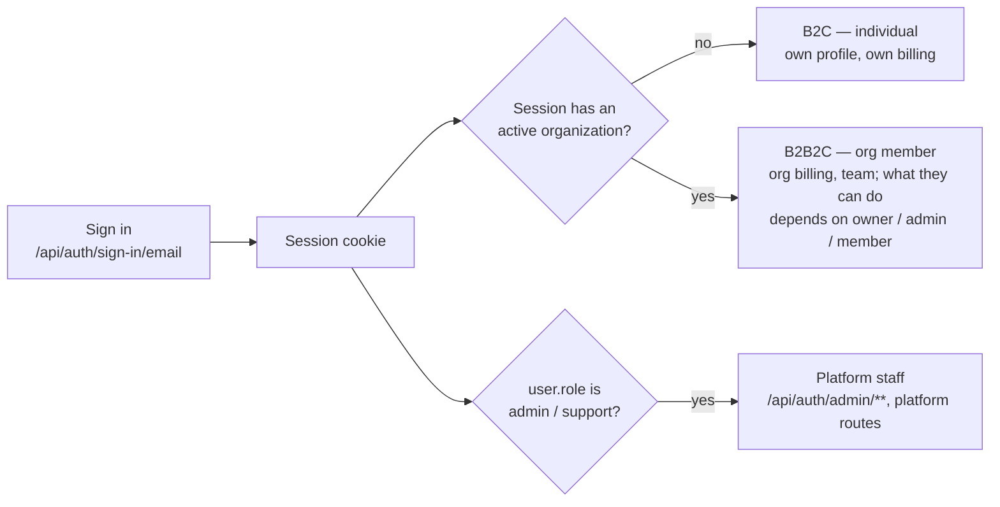
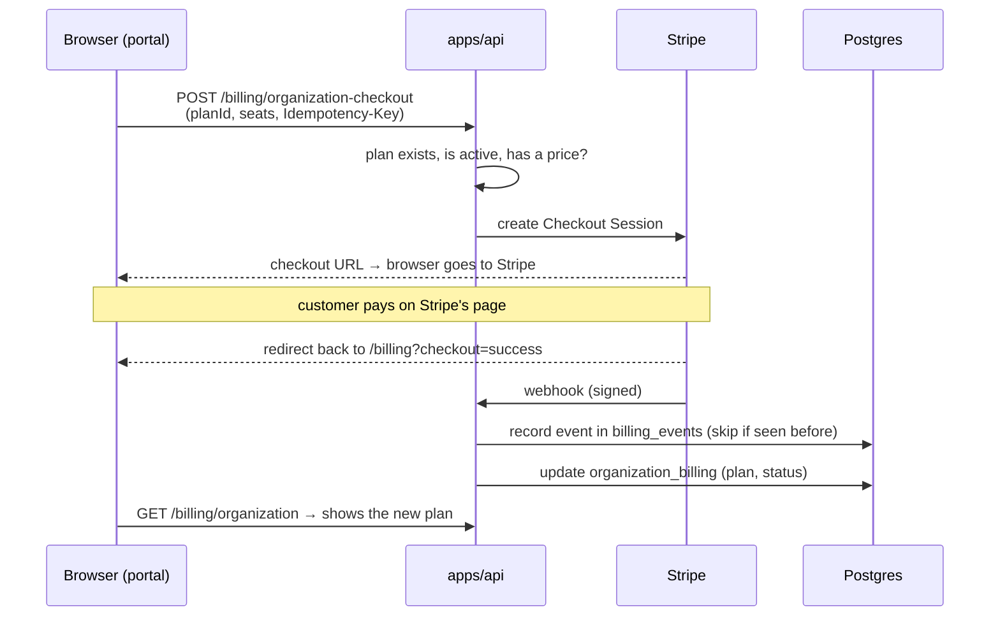
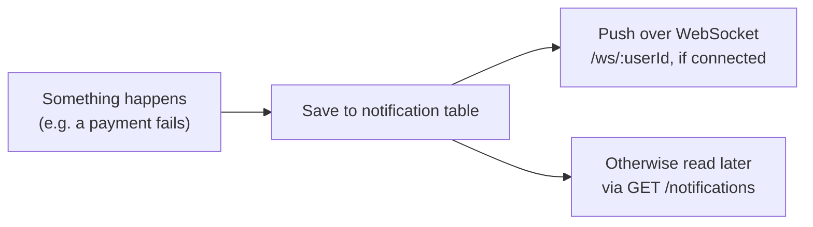

# Architecture

A bird's-eye view of how this repo fits together and how the main flows move through it. It's deliberately short — for the _rules_ (how to write code here) see [AGENTS.md](./AGENTS.md); for _what's shipped_, see [CHANGELOG.md](./CHANGELOG.md); for the reasoning behind a specific feature, see [specs/](./specs/) and [ENTITLEMENTS.md](./ENTITLEMENTS.md).

## The big picture

Two browser apps, one API, one database, one payment provider.



| Piece             | What it is                                                                                                     | Talks to                                  |
| ----------------- | -------------------------------------------------------------------------------------------------------------- | ----------------------------------------- |
| `apps/portal`     | Customer self-service: sign up/in, profile, billing (team management in progress)                              | `apps/api` only                           |
| `apps/admin`      | Staff back office: users, organizations, individuals, plan catalog, notifications                              | `apps/api` only                           |
| `apps/api`        | The only backend. Every request is authenticated, permission-checked and validated here                        | Postgres, Stripe                          |
| `packages/core`   | Pure logic — Better Auth config, permission statements, error codes, entitlement rules. No HTTP                | `packages/db` (for Better Auth's adapter) |
| `packages/db`     | Drizzle table definitions (the single source of truth for data shapes), the `db` client, RLS scope helpers     | Postgres                                  |
| `packages/shared` | Frontend plumbing both Next.js apps use — `apiFetch` (unwraps the response envelope), React Query client, `cn` | —                                         |

Two things worth knowing up front:

- **The frontends never touch the database or Stripe.** They call `apps/api` directly (no Next.js proxy route in between). Next.js's `proxy.ts` only checks a session cookie _exists_ to decide where to route the browser — `apps/api` re-checks the real session on every request.
- **One login system for everyone.** Better Auth (configured once, in `packages/core/src/auth`) handles customers and staff alike. What differs is the session: does it have an active organization (org member), a platform role (staff), or neither (individual)?

## How the code is layered



Arrows only point down. `packages/core` never imports Hono or anything from `apps/`, so its logic works the same from a script, a test, or a future non-HTTP entrypoint.

Inside `apps/api`, each feature is a folder under `src/modules/<feature>/` with the same split:

```
<feature>.routes.ts      which URL, which middleware, which handler — nothing else
<feature>.controller.ts  one small function per route: read input, call the service, respond
<feature>.service.ts     the actual steps (resolve a plan, call Stripe, decide outcomes)
<feature>.db.ts          the queries
<feature>.schema.ts      Zod request schemas
```

## Flow 1 — an ordinary API request

What happens when, say, the portal loads `GET /billing/organization`:



- **`injectUserContext`** turns the session cookie into a `userContext`: either `B2C` (an individual, no org) or `B2B2C` (has an active organization and a role in it). It returns 401 if there's no valid session.
- **`requirePermission({ billing: ["manage"] })`** checks the caller's org role against `packages/core/src/auth/permissions.ts`. Routes ask for a _permission_, never a role name.
- **Data access goes through a scope** — `withOrgScope`, `withUserScope`, or (only for trusted system work like webhooks) `withSystemScope`. Postgres Row-Level Security then enforces the same boundary a second time, so a bug in app code still can't read another tenant's rows.
- **Every response has one shape**: `{ success: true, data }` or `{ success: false, error: { code, message } }`. Code anywhere just `throw new AppError(...)`; one global `onError` formats it. (Exceptions: `/api/auth/**`, `/health`, and the Stripe webhook keep their own shapes.)

## Flow 2 — signing in and "which hat am I wearing?"



Org roles (`owner`/`admin`/`member`, on the `member` table) and platform roles (`admin`/`support`, on the `user` table) are two separate systems that happen to share the word "admin". They never mix.

## Flow 3 — buying a plan

Stripe, not this app, takes the payment. The app only starts the checkout and then _listens_ for what happened.



- **The webhook is the single source of truth** for subscription state. The redirect back only tells the browser "you finished checkout"; the plan changes when the webhook lands, a few seconds later. Cancel works the same way: the API asks Stripe to cancel, and the webhook updates the row — including putting it back on the free (default) plan, so paid features stop.
- **One subscription at a time.** Checkout always creates a _new_ Stripe subscription, so it's refused while one is live; changing plans means canceling first.
- **Duplicates are expected and handled.** Stripe can deliver the same webhook more than once or out of order; `billing_events` ignores an event id it has already seen, and older events can't overwrite newer state. On the way out, the `Idempotency-Key` stops a double-click from creating two checkouts.
- **Only one file knows Stripe exists** — `stripe-billing.service.ts`, behind the `BillingGateway` interface in `packages/core`. Swapping payment providers means replacing that one file.
- **Plans live in the database**, not in code (`subscription_plans`, edited by staff in `apps/admin`). What a plan _unlocks_ (`features`/`limits`) is checked by `requireFeature` — see [ENTITLEMENTS.md](./ENTITLEMENTS.md).

## Flow 4 — notifications



Saved first, pushed second — a dropped WebSocket never loses a notification, it just shows up on the next fetch.

## Where things live

| I want to…                        | Look at                                                   |
| --------------------------------- | --------------------------------------------------------- |
| Add an API feature                | `apps/api/src/modules/billing/` (the reference slice)     |
| Change who can do what            | `packages/core/src/auth/permissions.ts`                   |
| Add or change a table             | `packages/db/src/schema.ts`, then `pnpm db:generate`      |
| See all the middleware and routes | `apps/api/src/app.ts`                                     |
| Add a portal or admin page        | `apps/<app>/src/app/` (route) + `src/features/<feature>/` |
| Understand a design decision      | `specs/*.md`, `ENTITLEMENTS.md`, and AGENTS.md's sections |
